# Beauty and Blessed (Blessence) - Smart Beauty Recommendation and E-Commerce System

Blessence is an intelligent beauty e-commerce platform developed for Beauty & Blessed. It integrates computer vision and machine learning to eliminate the guesswork of buying makeup online. By analyzing individual skin tone, undertone, skin type, and specific skin concerns, the system recommends personalized cosmetic products using a Random Forest algorithm. In addition, the platform features an interactive Virtual Try-On tool that applies lipstick shades in real time and evaluates whether a selected shade looks flattering on the user based on color theory and undertone compatibility.

The platform provides a dual-portal experience: an intuitive online store and beauty consultant for customers, and a management and point-of-sale system for store administrators.

---

## Key Capabilities

### 1. AI-Driven Product Recommendations (Random Forest)
- The recommendation engine leverages a trained Random Forest model to calculate compatibility scores across cosmetic categories (foundation, lipstick, blush, eyeshadow, skincare).
- Product matching accounts for skin tone (Fair, Light, Medium, Tan, Deep), undertone (Cool, Warm, Neutral), skin type (Oily, Dry, Combination, Normal), finish preference (Matte, Dewy, Long-lasting), and specific concerns (Acne, Dryness, Dark Spots, Aging).
- Customers can generate recommendations through two convenient methods:
  - Live Face Scan: Camera-based analysis that automatically detects skin tone, undertone, and regional skin texture.
  - Interactive Beauty Quiz: A structured questionnaire for users who prefer manual input or do not have a camera available.

### 2. Virtual Lipstick Try-On and Shade Compatibility Analysis
- Uses facial landmark detection to identify lip contours and apply lipstick shades accurately with customizable opacity.
- Performs an algorithmic and database-driven shade compatibility evaluation to determine whether a lipstick color looks good on the person.
- Computes a match score and generates honest, actionable feedback explaining why a shade is flattering (e.g., undertone harmony, complementary contrast) or providing guidance if a shade clashes with the user's natural undertone.

### 3. Customer Features
- Personalized Experience: Face scan or quiz-based recommendations with clear compatibility indicators.
- Virtual Try-On Studio: Live or photo-based lipstick simulation with suitability assessment.
- Complete Shopping Experience: Product catalog with shade swatches, customer reviews, rating filters, and search.
- Cart and Checkout: Seamless cart management, secure checkout, order placement, and receipt generation.
- Order Management: Order history tracking, cancellation handling, and pickup verification via unique QR codes.
- User Account and Security: Google OAuth 2.0 social login, email verification via SMTP, password recovery, and suspicious activity detection.
- Favorites and Wishlists: Ability to bookmark preferred shades and products for future purchases.

### 4. Administrator and Staff Features
- Executive Dashboard: Real-time overview of revenue, sales trends, pending orders, and inventory status.
- Product and Variant Management: Create, update, and manage products with multiple shade variants, hex color values, formula types, pricing, and stock levels.
- Point of Sale (POS / Cashier Mode): Dedicated interface for in-store checkout, barcode/variant selection, and instant transaction processing.
- QR Code Scanner: Built-in scanner to verify customer pickup orders quickly and accurately.
- Recommendation Insights: Visual analytics on customer skin profiles, dominant skin tones and undertones, popular recommendations, and conversion metrics.
- Customer and Announcement Management: Customer database oversight, activity logging, and targeted email announcements.

---

## Visual Demonstration

### Mobile Experience: Face Scan and Smart Recommendations

| Camera Face Scan | Face Scan Analysis Results | Personalized Recommendations |
| :---: | :---: | :---: |
| 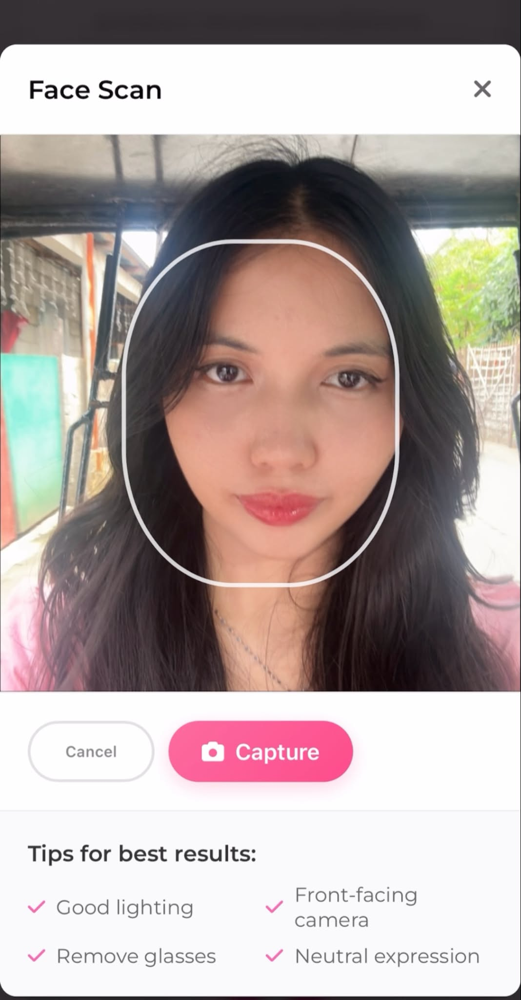 | 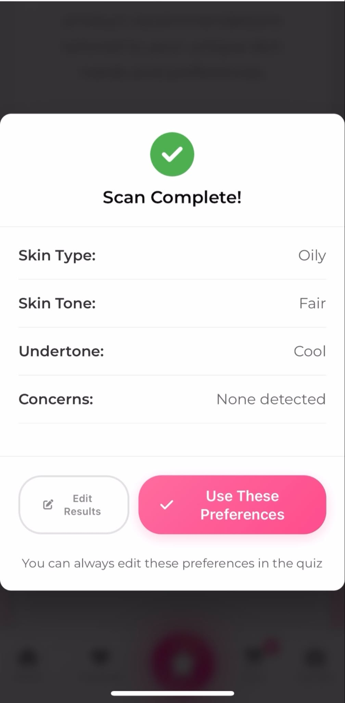 | 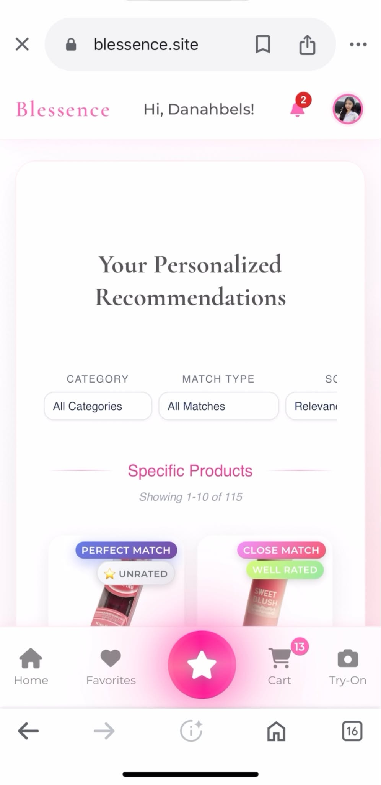 |

### Customer Web Experience

#### Storefront and Product Browsing
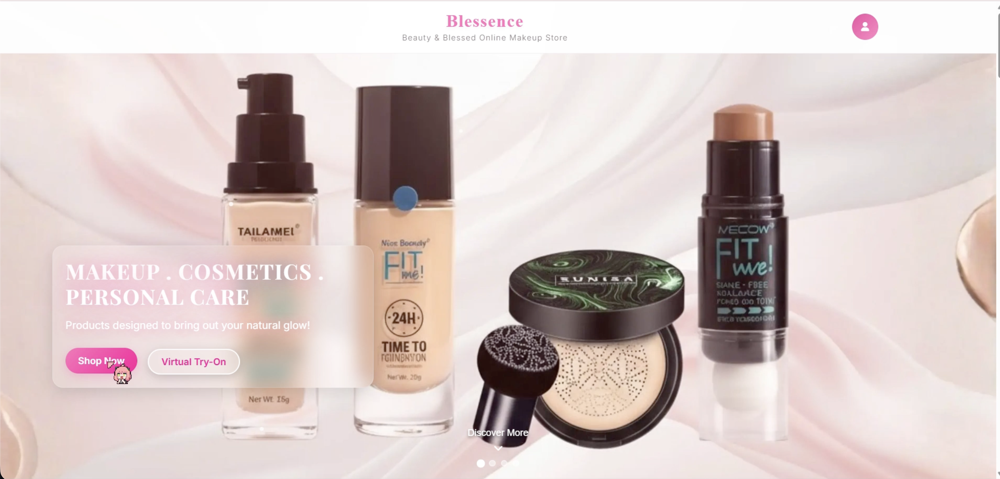

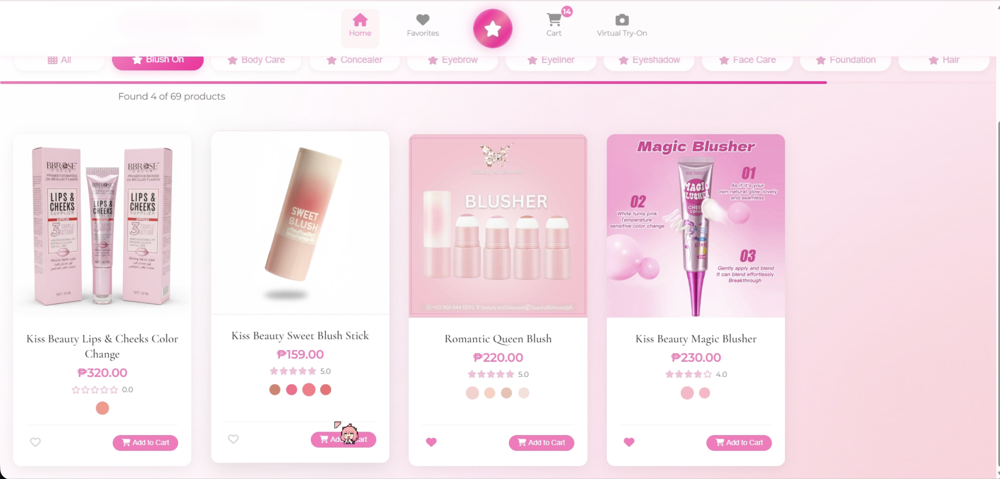

#### Interactive Beauty Quiz and Recommendation Results
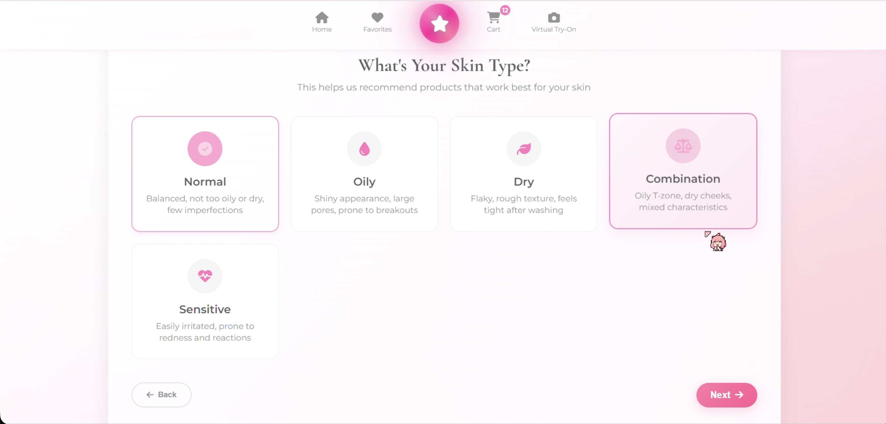

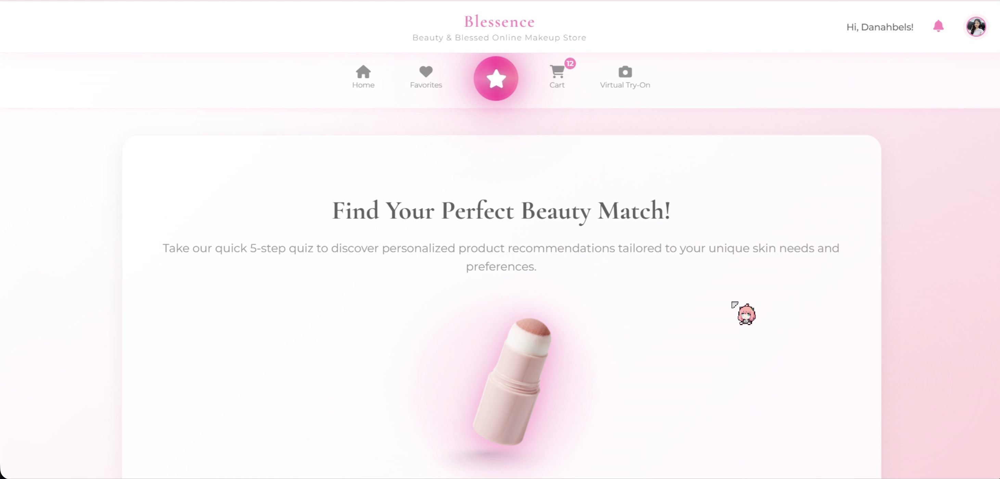

#### Virtual Try-On and Shade Suitability Analysis
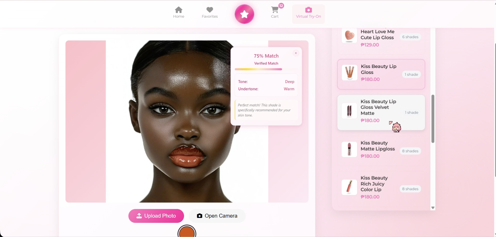

### Administrator Portal

#### Dashboard and Analytics
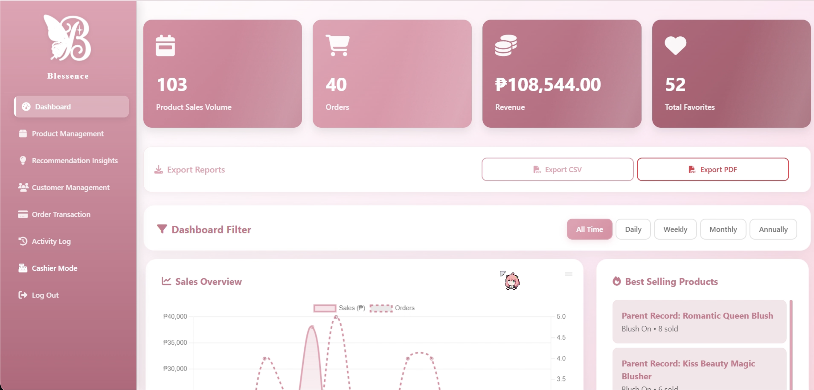

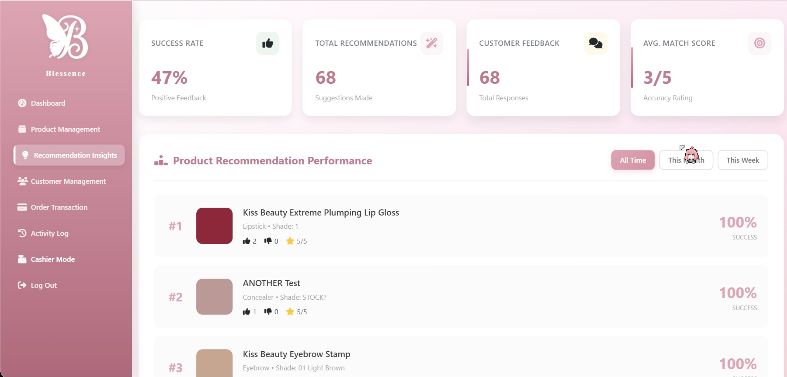

#### Product Management and Point of Sale (POS)
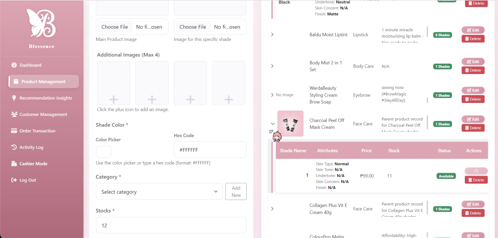

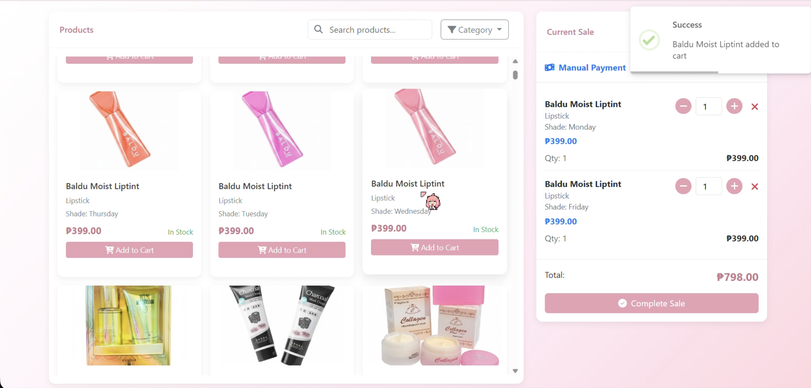

---

## Technology Stack

The platform is built using a hybrid architecture that pairs a high-performance web application backend with dedicated Python computer vision and machine learning services.

### Frontend
- HTML5: Semantic structure across customer pages and administrative interfaces.
- CSS3: Responsive layout system supporting both mobile devices and desktop displays.
- JavaScript (Vanilla ES6+): Dynamic client-side logic, camera stream handling, asynchronous API calls, and real-time DOM updates without heavy framework dependencies.

### Backend and Web Services
- PHP: Server-side API endpoints, business logic, session management, authentication workflows, order processing, and transaction handling.
- Python and Flask: Microservice layer that powers the machine learning recommendation engine and image processing endpoints, communicating with the PHP backend through RESTful JSON APIs.
- PHPMailer: SMTP email delivery for account verification, password resets, and customer notifications.

### Machine Learning and Computer Vision
- Scikit-Learn: Random Forest Regressor and Label Encoding for multi-attribute beauty product matching and personalized scoring.
- MediaPipe Face Mesh: High-density 468-point facial landmark detection for accurate lip segmentation and facial zone analysis.
- OpenCV: Image manipulation, color space conversion (BGR, RGB, HSV, LAB), skin region masking, and lipstick rendering.
- NumPy and Pandas: Numerical computation, matrix transformations, tabular data processing, and score aggregation.

### Database
- MySQL / MariaDB: Relational database storing product catalogs, multi-shade variants, customer profiles, preferences, shopping carts, transactions, audit logs, and recommendation statistics.

### Authentication and Security
- Google OAuth 2.0: One-click social login via Google Identity Services.
- Email Verification: Cryptographic token-based account verification.
- Security Utilities: Parameterized SQL queries, password hashing, session timeout management, and suspicious login monitoring.
